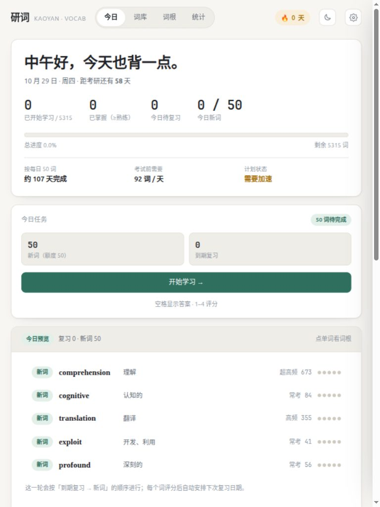

# 研词 · 考研英语词频词根记忆



一个纯静态的考研英语背单词网页：**按真题词频排序**，每个词都有**词根词缀拆解**，并配套每日计划、熟悉度勾选、间隔复习和统计。
全部数据在浏览器本地运行，不需要服务器、不需要登录。

词表默认隐藏 213 个基础虚词（a / the / this / of / and …），词库保留 **5315** 个有效词；需要完整大纲时可到设置里恢复为 5528 词。

> 打开方式：直接双击 `index.html`，或在目录里跑 `python3 -m http.server 8080` 后访问 <http://localhost:8080>。
> 学习记录保存在浏览器 localStorage，换浏览器/清缓存前请先在设置里导出备份。

---

## 功能

### 今日
- 考试倒计时、总进度、已掌握数、今日待复习
- 今日任务自动生成：**到期复习 → 新词**（可设置每日新词量和单次复习上限）
- 学习卡片：先回想，再显示释义；1–4 评分（忘记 / 模糊 / 认识 / 秒杀），每个按钮上直接显示下次复习间隔
- 右侧「今日清单」可**直接勾选今天背过的词**，也可点开单词调整熟悉度
- 备考计划：按当前额度估算完成天数，和考试日期对比，提示「进度安全 / 需要加速」

### 词库（默认 5315 词）
- 按词频、学习优先级、字母、熟悉度排序
- 搜索英文或中文释义
- 筛选：词频区间、CEFR 等级、首字母、未学 / 在学 / 待复习 / 已掌握 / 收藏 / 有笔记
- 每行右侧的 **×** 可从词库移除该词；详情抽屉底部也有「从词库移除」
  - 移除后 15 秒内可点底部提示的「撤销」恢复
  - 移除只是隐藏，学习记录会保留；漏了撤销可到 设置 → 数据 →「恢复已移除的词」
- 点任意一行打开详情抽屉：音标、发音、例句（含真题出处）、词根词缀、同根词、词源、记忆辅助、个人笔记、熟悉度
- 「未归类」筛选：查看没有稳定词根结构的词（约 4139 个），这些词的详情页仍然有逐词词根/词缀解析

### 词根
- 页面顶部显示词根覆盖率：当前 **1176 / 5315 词（22%）** 能可靠归入词族；其余词没有稳定的词根结构，可一键跳到「未归类」
- 按词族大小排序（默认展示有考研词命中的 167 个词根），可搜索词根或中文含义
- 每个词根展示变体、含义、词源、例词
- 列出该词根下的全部考研词，点词直接打开详情

### 统计
- 熟悉度分布、近 7 天完成量、未来 7 天复习量预测
- CEFR 等级覆盖进度、最近 5 周打卡热力图、连续打卡天数

### 数据
- 一键导出 / 导入 JSON 备份
- 清空记录重新开始
- 深浅色主题（可跟随系统）

---

## 记忆算法

`js/scheduler.js` 里是纯函数 `next(state, grade)`，与 UI 解耦，方便替换成 FSRS / 超级记忆等算法。

- 熟悉度 0–5：未学 / 生词 / 眼熟 / 认识 / 熟练 / 掌握
- 每个词维护 `lv`（等级）、`iv`（当前间隔天数）、`due`（下次复习日）、`ease`（难度因子，初始 2.5）
- 评分：
  - **忘记**：等级回到 1，当天重来，ease −0.2
  - **模糊**：等级 −1，间隔约为上次的 40%，ease −0.15
  - **认识**：等级 +1，间隔 × ease
  - **秒杀**：等级 +2，间隔 × ease × 1.3
- 间隔上限 180 天，保证考研周期内不会「排到考试之后」
- 新词进入队列时按「学习优先级」排序（词频 × CEFR 难度 × 学术/高级词权重），也可在设置里改成纯词频

---

## 词根词缀是怎么来的

每个词的词根信息由两层组成，互相兜底：

1. **逐词整理**（`data/words.js` 的 `rt` / `af` / `mem` / `hist` 字段）
   来自开源词库的逐词词根、词缀、记忆辅助、词源说明，覆盖约 95% 的词条。
2. **规则拆解**（`js/morphology.js` + `data/affixes.js`）
   用 169 个词根、52 个前缀、27 组后缀做「前缀 + 词根 + 后缀」匹配，拆出的色块拼合必须 100% 还原单词；拆不准就显示为「基础词」，绝不硬拆。

同根词由拆解结果聚合而来，并带一张人工校正表（`js/app.js` 里的 `FAMILY_EXCLUDE`），发现误收的词直接往里加即可。

---

## 目录结构

```
kaoyan-vocab/
├── index.html
├── css/app.css
├── data/
│   ├── words.js        # 5528 词（自动生成，勿手改）
│   ├── basic-words.js  # 基础虚词表（默认隐藏，可手改）
│   └── affixes.js      # 词根 / 前缀 / 后缀数据库（可手改）
├── js/
│   ├── morphology.js   # 构词拆解引擎（纯函数）
│   ├── store.js        # localStorage 持久化 + 版本迁移
│   ├── scheduler.js    # 间隔重复算法
│   ├── queue.js        # 今日队列 / 日历 / 统计
│   └── app.js          # 视图与交互
├── scripts/
│   └── build_words.py  # 从原始数据生成 data/words.js
└── README.md
```

没有构建步骤、没有依赖，改完刷新即可。

---

## 扩展指南

### 1. 加词 / 换词表

`data/words.js` 的结构：

```js
window.KY_WORDS = {
  meta: { count, withRoots, sources, ... },
  words: [{
    id, w: 'comprehension', f: 673, t: '理解',
    cat: '思考、推理与分析', cefr: 'B2', acad: true, adv: false,
    ex: 'reading comprehension', exz: '阅读理解力', exs: '真题 2021英二·T4', z: 1,
    ph: 'ˌkɑːmprɪˈhenʃn',
    rk: 1,                     // 学习优先级序号
    rt: '词根说明', af: '词缀说明', mem: '记忆辅助', hist: '词源'
  }]
};
```

改词表后刷新即可（`js/app.js` 会自动重建索引）。
也可以直接编辑 `scripts/build_words.py`，从自己的 JSON/CSV 生成同样的结构。

### 2. 调整基础虚词

编辑 `data/basic-words.js`，增删小写单词即可。它是「封闭类词」白名单：
冠词、代词、限定词、介词、连词、助动词、程度副词、基础数词。
make / take / work / people 这类高频实词不在其中。

设置里可以随时勾选「词库隐藏基础虚词」，无需改文件。

### 3. 加词根 / 词缀

编辑 `data/affixes.js`：

```js
{ k: 'prehend', v: ['prehend', 'prehens'], m: '抓住、理解',
  o: '拉丁 prehendere（抓住）', ex: ['comprehend', 'apprehend'] }
```

- `k` 是词族主键，用于同根词聚合
- `v` 是拼写变体（支持同化拼写，如 con-/com-/col-/cor-）
- 加完刷新，构词拆解和词根页会自动更新

### 4. 换记忆算法

`js/scheduler.js` 的 `next(state, grade)` 是纯函数：传入当前状态和评分，返回新状态。
换成 FSRS 只需保持返回字段 `{ lv, iv, due, reps, lapses, ease, first, last }` 不变。

### 5. 存储升级

`js/store.js` 里有 `VERSION` 和 `MIGRATIONS` 表。加字段时：
1. 写进 `DEFAULT_STATE()`
2. 在 `MIGRATIONS` 里补一条升级函数
3. 旧数据会在下次打开时自动迁移

### 6. 加新视图

1. `index.html` 的 `#tabs` 加一个 `data-view="xxx"` 按钮
2. `js/app.js` 的 `VIEWS` 里注册 `xxx: renderXxx`
3. 需要的话补 CSS

---

## 数据来源与授权

| 来源 | 用途 | 授权 |
| --- | --- | --- |
| [exam-data/NETEMVocabulary](https://github.com/exam-data/NETEMVocabulary) | 5530 词表、真题词频排序、释义、例句、语义分类、CEFR 等级、智能重排序号 | CC BY-NC-SA 4.0 |
| [vxiaozhi/vocabulary-book-by-deepseek](https://github.com/vxiaozhi/vocabulary-book-by-deepseek) | 逐词词根 / 词缀 / 记忆辅助 / 词源解析 | Apache-2.0 |
| [KyleBing/english-vocabulary](https://github.com/KyleBing/english-vocabulary) | 美式音标 | BSD-3-Clause |

- 词频来自约 200 套四六级、考研、专四专八试卷文本统计；前 2444 词出现 40 次以上。
- 词根解析与部分例句由 AI 生成，已做初步校对，但难免有疏漏；发现错误可直接改 `data/words.js` 对应字段，或用 `scripts/build_words.py` 重新生成。
- 本仓库以 **CC BY-NC-SA 4.0** 发布（代码 + 整理数据），仅限非商业用途；完整的第三方授权见 [NOTICE.md](NOTICE.md)。

---

## 已知限制

- 词表是 2024 考研英语（一）大纲的 5530 词，其他年份/英语二的差异未单独标注。
- 默认发音走浏览器 Web Speech API：音色取决于操作系统装了什么英文语音；如果系统里没有英文语音，会提示而不是用中文语音硬读。
- 设置 →「发音方式」可切换成有道在线美音（`dict.youdao.com/dictvoice`，需联网，非官方接口，可能限流）。
- 自动拆解对部分拉丁语同化拼写（如 assimilation）无能为力，会退回「基础词」，此时以上方的逐词解析为准。
- 数据全部在本地，多设备不同步；用导出/导入 JSON 迁移。

## 后续可以加

- [ ] 错题本 / 只练「忘记」过的词
- [ ] 单词听写与拼写测试
- [ ] 按真题年份/题型筛选
- [ ] FSRS 算法与参数可视化
- [ ] PWA 离线安装与通知提醒
